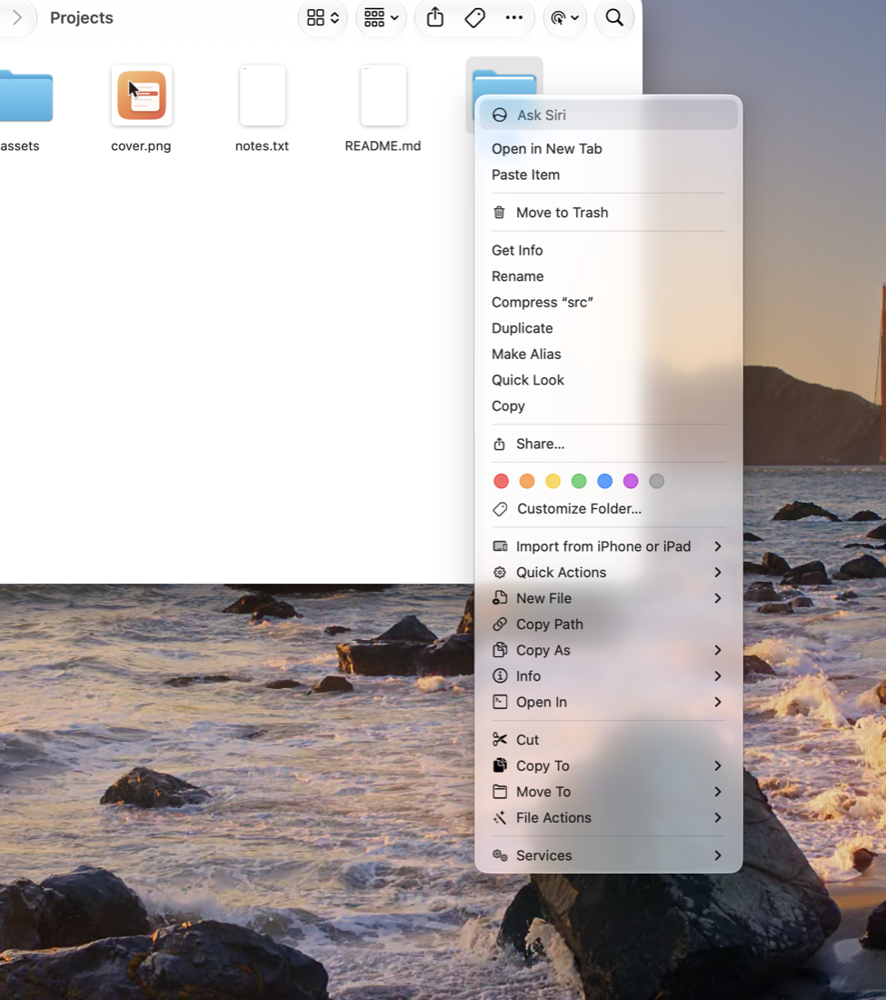
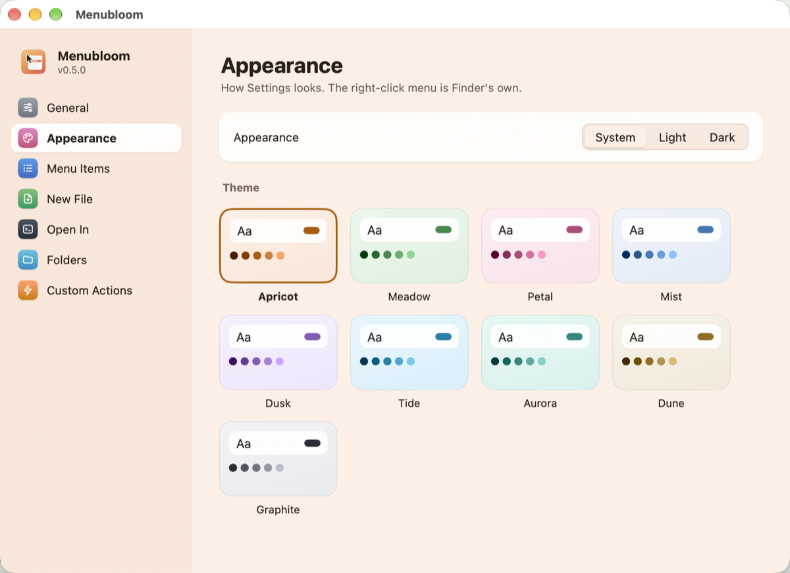

<p align="center">
  
</p>

<h1 align="center">Menubloom</h1>

<p align="center">
  <b>The right-click menu your Mac is missing.</b><br>
  <a href="#download">Download</a> ·
  <a href="#what-it-adds">What it adds</a> ·
  <a href="#build-from-source">Build from source</a><br>
  <b>English</b> · <a href="README.zh-CN.md">简体中文</a>
</p>

<p align="center">
  <a href="https://github.com/lzhgus/menubloom/releases/latest"></a>
  <a href="LICENSE"></a>
</p>

<p align="center">
  
</p>

<p align="center">
  
</p>

<p align="center">
  <a href="assets/promo/menubloom-promo-20s.mp4">Watch the 20-second demo video (MP4)</a>
</p>

## Why

On Windows, you right-click in a folder and make a new text file, copy a
file's path, or open a terminal right there. On the Mac, Finder's right-click
can't do any of it: there's no **New ▸ Text Document**, no **Copy as path**,
no **Cut** and **Paste**, no **Open in Terminal**. You end up opening an app to
save an empty file, dragging a file into Terminal to get its path, or
remembering that ⌘⌥V moves what ⌘C copied.

We hit this every day, and it's the first thing people who come to the Mac
from Windows ask about. Menubloom puts those things back into Finder's
right-click, plus the ones developers and power users reach for. It's one
switch to turn on, with no folders to authorize.

## Download

**[Download the latest release](https://github.com/lzhgus/menubloom/releases/latest)**:
a signed and notarized universal app (Apple Silicon and Intel) for macOS 12 or
newer.

1. Open the DMG and drag **Menubloom** to Applications.
2. Open it. Settings shows a short checklist: turn on the Finder extension and,
   if you like, open at login.
3. Right-click in any Finder window.

## What it adds

| Item | Where | What it does |
|---|---|---|
| **New File ▸** | folder background, a folder, the toolbar | creates `Untitled.<ext>` from a template (Text, Markdown, Word, Excel, RTF, HTML, JSON, CSV, Python, Shell) and selects it. **Any file you drop into the Templates folder becomes a new kind**, as on Windows |
| **Copy Path** | everywhere | the full path of the selection or the folder, one per line |
| **Copy As ▸** | everywhere | name, name without extension, `~` path, shell-quoted path, `file://` URL, Markdown link; a text file's contents; a folder's tree; MD5 / SHA-1 / SHA-256 |
| **Info ▸** | one item | size, created and modified dates right in the menu, and an image's dimensions; click one to copy it |
| **Open In ▸** | everywhere | Terminal, iTerm, Ghostty, Warp, VS Code, Cursor, Zed… (detected, plus any app you add); a terminal opens the folder of a file |
| **Cut**, then **Paste Here** | items, then a folder | moves files, Windows style: names that are taken get a number, and it works across disks |
| **Copy To ▸ / Move To ▸** | items | to your favorite folders, or **Other Folder…** |
| **File Actions ▸** | items | make a real Finder alias (it follows the file when it moves), make a symlink, make executable, remove quarantine, dissolve a folder, delete immediately (after asking) |
| **Convert Image ▸ / Resize Image ▸** | images | a PNG, JPEG, HEIC, TIFF or ICNS (every size from 16 to 1024) beside the original, or a copy 2048, 1024, 512 or 256 px on its longer side |
| **Show / Hide Hidden Files** | folder background | toggles Finder's hidden files |
| **Custom actions** | where you choose | your own shell commands, with the selected paths as `"$@"`; shown only for the file types, number of items and folders you pick; in the background or in a Terminal window; with a global shortcut if you want one |

In **Settings** (menu bar icon ▸ Settings…) you can turn any group off, move it
up or down, or show its items **inline** instead of in a submenu. Settings and
the menu speak English or 简体中文, and come in nine color themes, light or dark.

<p align="center">
  
</p>

### iCloud Drive, Dropbox and OneDrive

Finder doesn't show extension menus in cloud folders. There, Menubloom's
most-used items are in **right-click ▸ Services**: *Copy Path, Copy Name, Open
in Terminal, Open in Editor, New Text File Here, Cut, Paste Here, Copy To…,
Move To…*. If they're missing, turn them on in System Settings ▸ Keyboard ▸
Keyboard Shortcuts ▸ Services ▸ Files and Folders.

### Scripts and Shortcuts

Every item also runs from the command line, so from scripts, Shortcuts' *Run
Shell Script*, Raycast or Alfred:

```sh
SC="/Applications/Menubloom.app/Contents/MacOS/Menubloom"
"$SC" run copy:path ~/Desktop/a.txt     # Copy Path
"$SC" run new:.md ~/notes               # a new Markdown file in ~/notes
"$SC" run img:png photo.heic            # Convert Image ▸ PNG
"$SC" run open:terminal .               # open this folder in your terminal
```

Ids: `copy:path|name|stem|tilde|quoted|url|md|contents|tree`, `hash:md5|sha1|sha256`,
`info:size|created|modified|dimensions`, `new:<template file or .ext>`, `cut`, `paste`,
`copyto:<folder>`, `moveto:<folder>`, `file:alias|symlink|exec|unquarantine|dissolve|delete`,
`img:png|jpeg|heic|tiff|icns`, `resize:<px>`, `open:<app path>|terminal|editor`,
`act:<custom action id>`, `hidden`.

### If the items don't show

- **Settings ▸ General** says whether the Finder extension is on, and turns it
  on. So does System Settings ▸ General ▸ Login Items & Extensions ▸ Finder.
- The first right-click right after Finder starts can come before the extension
  has loaded. The next one has the items.
- **Restart Finder**, in the menu bar icon's menu, helps after an update.

## Privacy

Menubloom makes no network connections and collects nothing. Its settings
stay on your Mac, in `~/Library/Application Support/Menubloom/`.

## Build from source

You need macOS 12+, [Go](https://go.dev/dl/) 1.27.3+ and Xcode's command line
tools (`swiftc`).

```sh
git clone https://github.com/lzhgus/menubloom.git
cd menubloom
scripts/build.sh --install     # build, install into /Applications, enable the extension, open it
```

```sh
scripts/build.sh               # just build: build/darwin-universal/Menubloom.app
go test ./...                  # the app's logic
scripts/check-extension.sh     # the Finder extension's menu logic, against the app's menu.json
MENUBLOOM_NOTARY=<profile> scripts/build.sh --release   # a notarized DMG
```

`SIGN` picks the signing identity. The default is your first Developer ID
Application certificate, or else ad hoc, which runs on your Mac only.
`--release` needs a profile from `xcrun notarytool store-credentials`.

## How it works

```
Finder ──right-click──▶ MenubloomFinder.appex (Swift, sandboxed)
                          │ reads ~/Library/Application Support/Menubloom/menu.json
                          │ click → menubloom://run?t=<token>&id=<item>&target=…&p=…
                          ▼
                        Menubloom.app (Go, not sandboxed)
                          checks the token, runs the action, writes menu.json
```

- **The app** is written in Go with [MyGo](https://github.com/egoist/mygo): the
  menu bar icon, Settings in MyGo's native UI, the macOS Services, and every
  action. It turns your settings into `menu.json`.
- **The Finder extension** (`extension/FinderSync.swift`, about 200 lines) is the
  one piece that macOS only accepts as a native app extension. It draws
  `menu.json` for where you clicked and what's selected, and sends the click back
  to the app. Its sandbox can read only the app's folder.
- **Security.** Any web page can open a `menubloom://` link, so every request
  carries a random token that only the extension can read; the app drops
  requests without it. Custom actions get paths as arguments, never pasted into
  the command, so a file named `$(rm -rf ~)` is just a name.

## License

MIT
