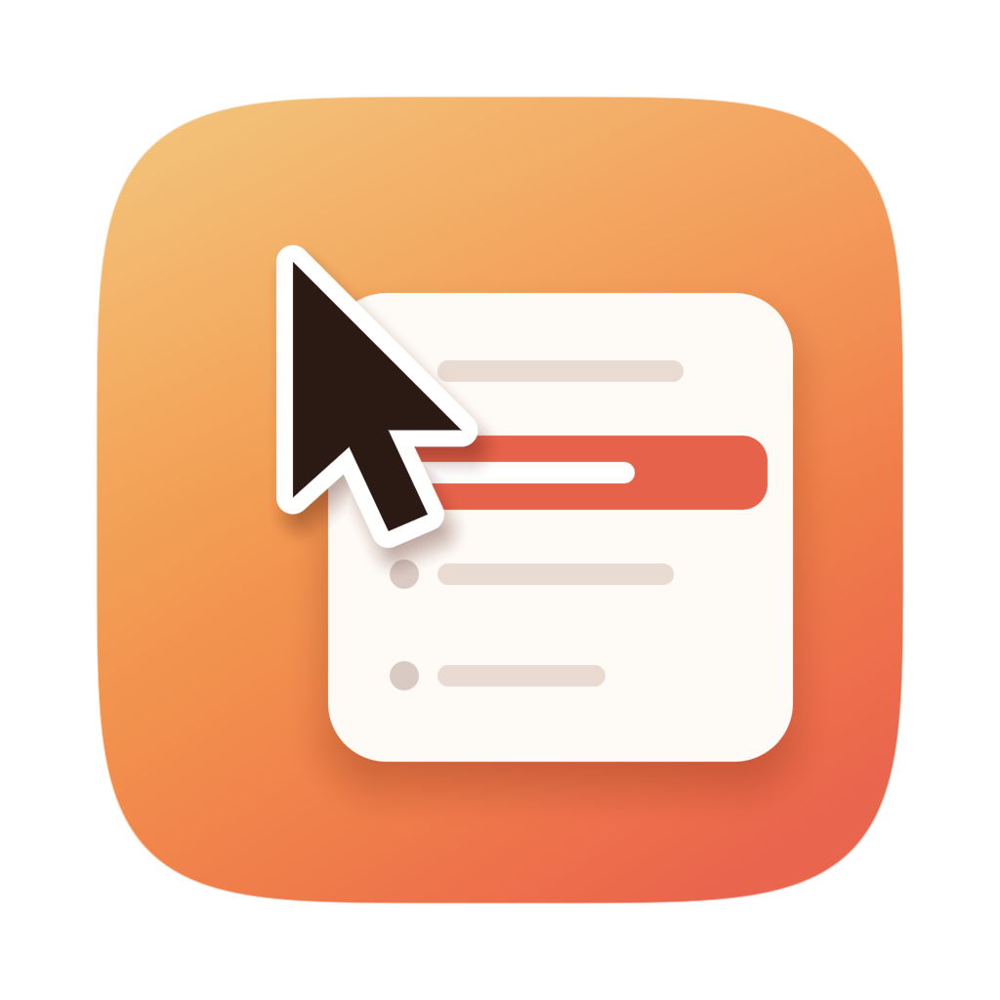
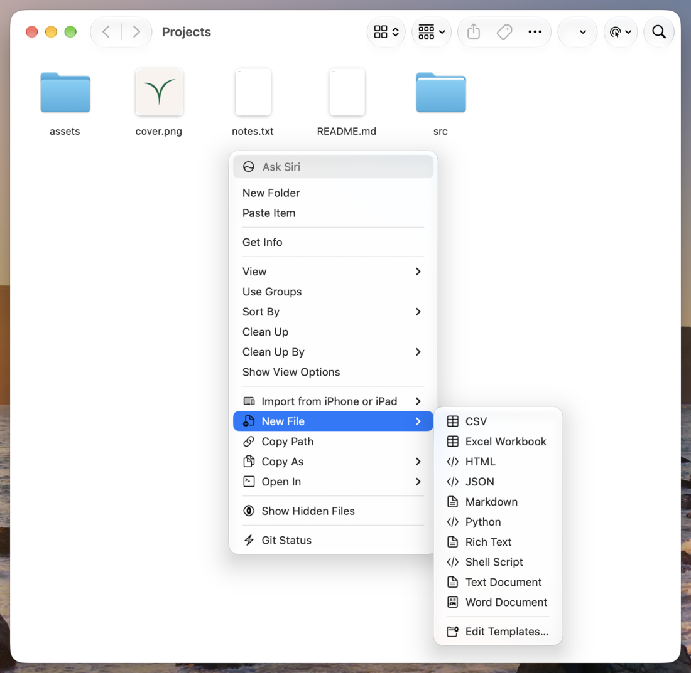

<p align="center">
  
</p>

<h1 align="center">Menubloom</h1>

<p align="center">
  <b>补齐 Mac 右键菜单缺的那些功能。</b><br>
  <a href="#下载">下载</a> ·
  <a href="#加了什么">加了什么</a> ·
  <a href="#从源码构建">从源码构建</a><br>
  <a href="README.md">English</a> · <b>简体中文</b>
</p>

<p align="center">
  <a href="https://github.com/lzhgus/menubloom/releases/latest"></a>
  <a href="LICENSE"></a>
</p>

<p align="center">
  
</p>

<p align="center">
  
</p>

<p align="center">
  <a href="assets/promo/menubloom-promo-20s.mp4">观看 20 秒演示视频（MP4）</a>
</p>

## 为什么做

在 Windows 上，在文件夹里点右键，就能新建文本文档、复制文件路径、在这里打开终端。
到了 Mac 上，访达的右键这些都做不到：没有 **新建 ▸ 文本文档**，没有 **复制为路径**，
没有 **剪切** 和 **粘贴**，也没有 **在终端中打开**。只好先打开一个 App 存个空文件，
把文件拖进终端才拿到路径，或者记住 ⌘C 之后要按 ⌘⌥V 才是“移动”。

这是我们每天都会遇到的痛点，也是从 Windows 转到 Mac 的人最先问的问题。
Menubloom 把这些功能放回访达的右键菜单，再加上开发者和重度用户常用的那些。
打开一个开关就能用，不用逐个授权文件夹。

## 下载

**[下载最新版本](https://github.com/lzhgus/menubloom/releases/latest)**：
经过签名和公证的通用版 App（Apple 芯片和 Intel 都可以），支持 macOS 12 及以上。

1. 打开 DMG，把 **Menubloom** 拖到“应用程序”。
2. 打开它。设置里有一份简短的清单：打开访达扩展，需要的话再打开“登录时打开”。
3. 在任意访达窗口里点右键。

## 加了什么

| 项目 | 出现在 | 做什么 |
|---|---|---|
| **新建文件 ▸** | 文件夹空白处、文件夹、工具栏 | 用模板（文本、Markdown、Word、Excel、RTF、HTML、JSON、CSV、Python、Shell）新建 `Untitled.<扩展名>` 并选中它。**放进模板文件夹的任何文件都会变成一种新建文件**，和 Windows 一样 |
| **拷贝路径** | 任何地方 | 所选项目或当前文件夹的完整路径，一行一个 |
| **拷贝为 ▸** | 任何地方 | 名称、不含扩展名的名称、`~` 路径、带引号的路径、`file://` URL、Markdown 链接；文本文件的内容；文件夹的目录树；MD5 / SHA-1 / SHA-256 |
| **简介 ▸** | 单个项目 | 菜单里直接显示大小、创建和修改时间，还有图片尺寸；点一下即可拷贝 |
| **打开方式 ▸** | 任何地方 | 终端、iTerm、Ghostty、Warp、VS Code、Cursor、Zed……（自动检测，也可以添加任意 App）；终端会打开文件所在的文件夹 |
| **剪切**，再 **粘贴到这里** | 先选项目，再到文件夹 | 像 Windows 一样移动文件：重名会自动编号，跨磁盘也可以 |
| **拷贝到 ▸ / 移动到 ▸** | 所选项目 | 送到常用文件夹，或者 **其他文件夹…** |
| **文件操作 ▸** | 所选项目 | 制作真正的访达替身（原文件移动后仍能找到）、制作软链接、添加执行权限、移除隔离属性、解散文件夹、立即删除（会先确认） |
| **转换图片 ▸ / 调整图片尺寸 ▸** | 图片 | 在原图旁边生成 PNG、JPEG、HEIC、TIFF 或 ICNS（含 16 到 1024 全部尺寸），或者长边为 2048、1024、512、256 px 的副本 |
| **显示 / 隐藏隐藏文件** | 文件夹空白处 | 切换访达是否显示隐藏文件 |
| **自定义动作** | 你决定 | 你自己的 Shell 命令，所选路径就是 `"$@"`；可以限定文件类型、选中数量和文件夹；在后台运行或在终端窗口里运行；还可以设全局快捷键 |

在 **设置**（菜单栏图标 ▸ 设置…）里，每一组都可以关闭、上下移动，或者 **展开**
到顶层而不放在子菜单里。设置和菜单支持英文和简体中文，有九种配色主题，浅色深色都有。


### iCloud 云盘、Dropbox 和 OneDrive

访达在云盘文件夹里不显示扩展菜单。在那里，Menubloom 最常用的功能在
**右键 ▸ 服务** 里：拷贝路径、拷贝名称、在终端中打开、在编辑器中打开、在此新建文本文件、
剪切、粘贴到这里、拷贝到…、移动到…。如果没看到，到 系统设置 ▸ 键盘 ▸ 键盘快捷键 ▸
服务 ▸ 文件和文件夹 里打开。

### 脚本和快捷指令

每个项目都能从命令行运行，所以脚本、快捷指令的“运行 Shell 脚本”、Raycast、Alfred 都能用：

```sh
SC="/Applications/Menubloom.app/Contents/MacOS/Menubloom"
"$SC" run copy:path ~/Desktop/a.txt     # 拷贝路径
"$SC" run new:.md ~/notes               # 在 ~/notes 里新建 Markdown 文件
"$SC" run img:png photo.heic            # 转换图片 ▸ PNG
"$SC" run open:terminal .               # 在终端里打开当前文件夹
```

全部 id 见 [English README](README.md#scripts-and-shortcuts)。

### 如果看不到菜单项

- **设置 ▸ 通用** 会显示访达扩展是否打开，并可以一键打开。也可以在 系统设置 ▸ 通用 ▸
  登录项与扩展 ▸ 访达 里打开。
- 访达刚启动时的第一次右键，扩展可能还没加载好，再右键一次就有了。
- 更新之后，可以用菜单栏图标菜单里的 **重新启动访达**。

## 隐私

Menubloom 不联网，也不收集任何数据。设置都保存在你的 Mac 上：
`~/Library/Application Support/Menubloom/`。

## 从源码构建

需要 macOS 12+、[Go](https://go.dev/dl/) 1.27.3+ 和 Xcode 命令行工具（`swiftc`）。

```sh
git clone https://github.com/lzhgus/menubloom.git
cd menubloom
scripts/build.sh --install     # 构建、安装到“应用程序”、打开扩展并启动
```

更多构建方式和工作原理见 [English README](README.md#build-from-source)。

## 许可证

MIT
